# E-Shongskar (ই-সংস্কার) — Let's reform together

A community platform for Bangladesh where neighbours in the same area report local problems, organise community work, find blood donors and keep each other safe. Verified local representatives and administrators help move problems toward solutions.

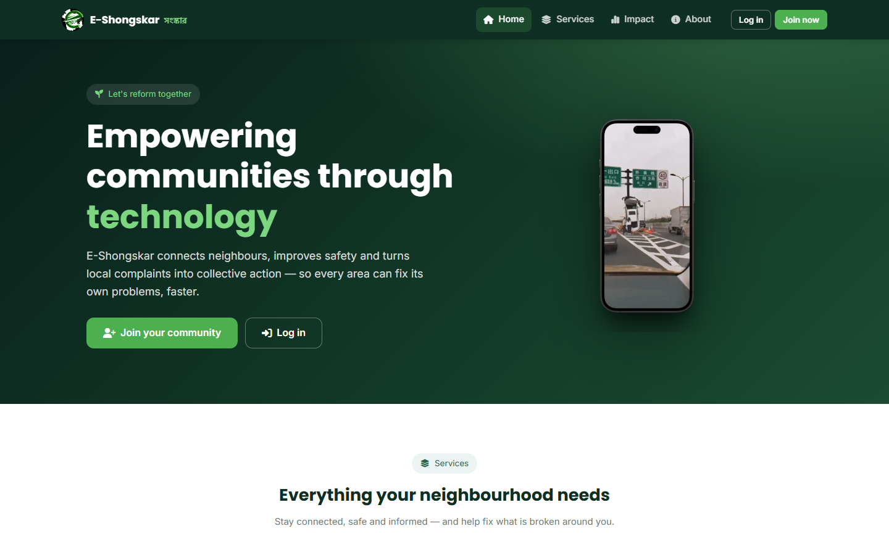

## Tech stack

| Layer | Technology |
|---|---|
| Backend | PHP 8 (plain PHP, no framework), server-rendered pages |
| Database | MySQL / MariaDB 10.4+ through PDO with prepared statements, plus a `user_scores` SQL view for the leaderboard |
| Frontend | HTML5, custom CSS (`assets/css/app.css`), vanilla JavaScript (`assets/js/app.js`) |
| UI libraries | Font Awesome 6 (icons), Google Fonts (Inter, Poppins, Hind Siliguri) |
| Charts | Chart.js 4 (admin dashboard) |
| Browser APIs | Geolocation API (attaches your location to SOS requests) |
| Server | Apache through XAMPP; `.htaccess` blocks direct access to `includes/`, `database/` and uploaded scripts |
| Security | `password_hash` / `password_verify`, CSRF tokens on every form, HTTP-only session cookies, output escaping, upload type and size checks |

## System architecture

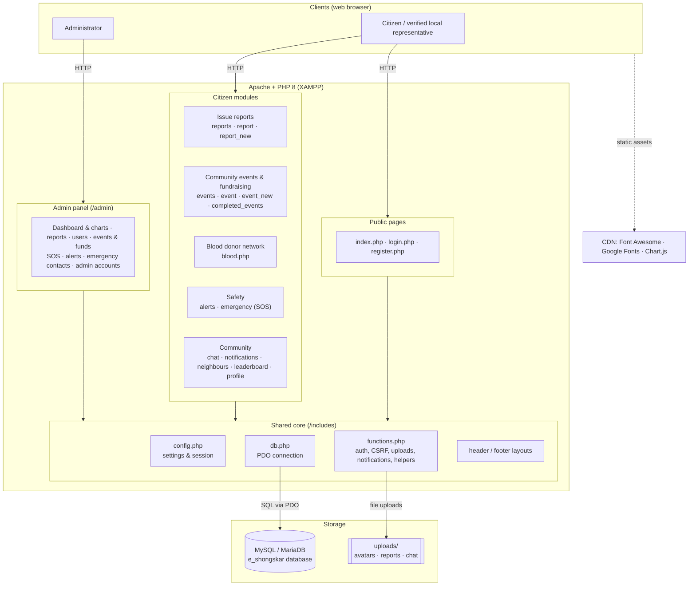

**Request flow:** every page loads `includes/functions.php`, which brings in the configuration, the session and the PDO connection. The page checks whether the visitor is logged in (citizen or admin), validates the CSRF token on form posts, runs its queries, records notifications for the users affected, and renders HTML using the shared header and footer layouts.

**Main data model:** `users`, `admins` → `reports` (+ `report_votes`) · `events` (+ `event_likes`, `event_comments`, `event_participants`, `event_funds`, `donations`) · `blood_donors`, `blood_requests` · `alerts`, `emergency_contacts`, `sos_requests` · `messages`, `notifications`.

## Screenshots

> Captured with demo data. All names and numbers are fictional.

### Citizen dashboard
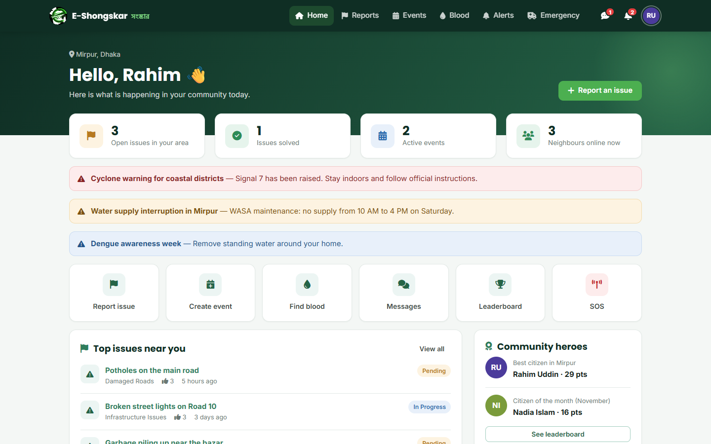

### Issue reports
| Reports in your area | Report details |
|---|---|
| 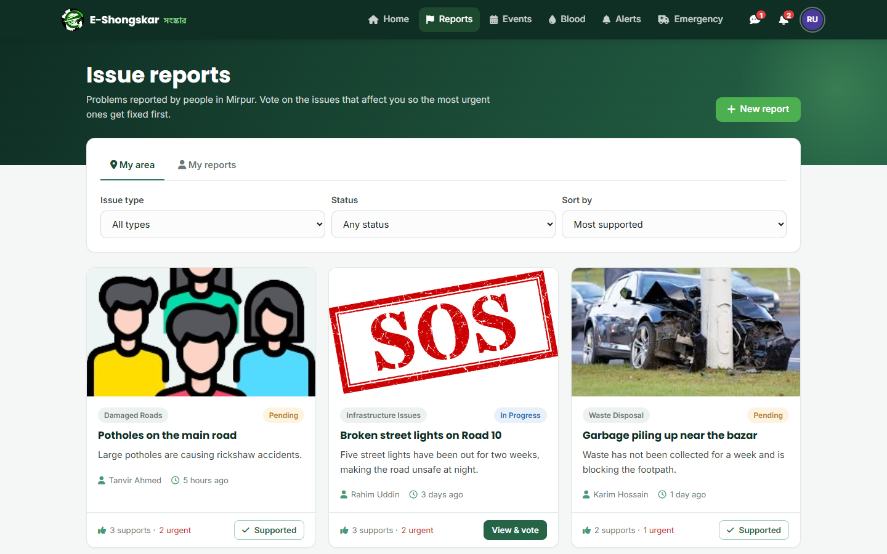 | 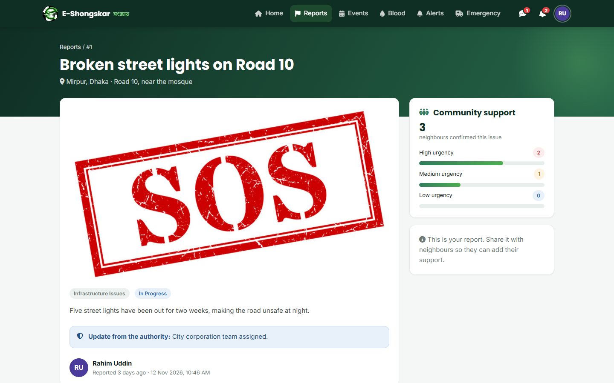 |

### Community events & fundraising
| Events | Event with fundraiser, discussion and participants |
|---|---|
| 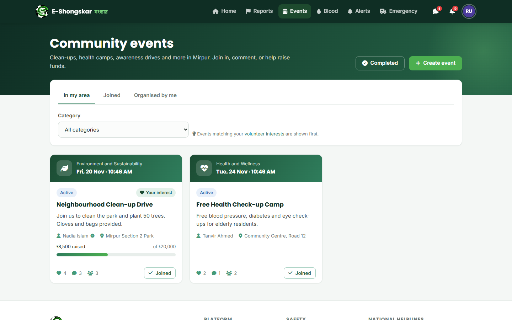 | 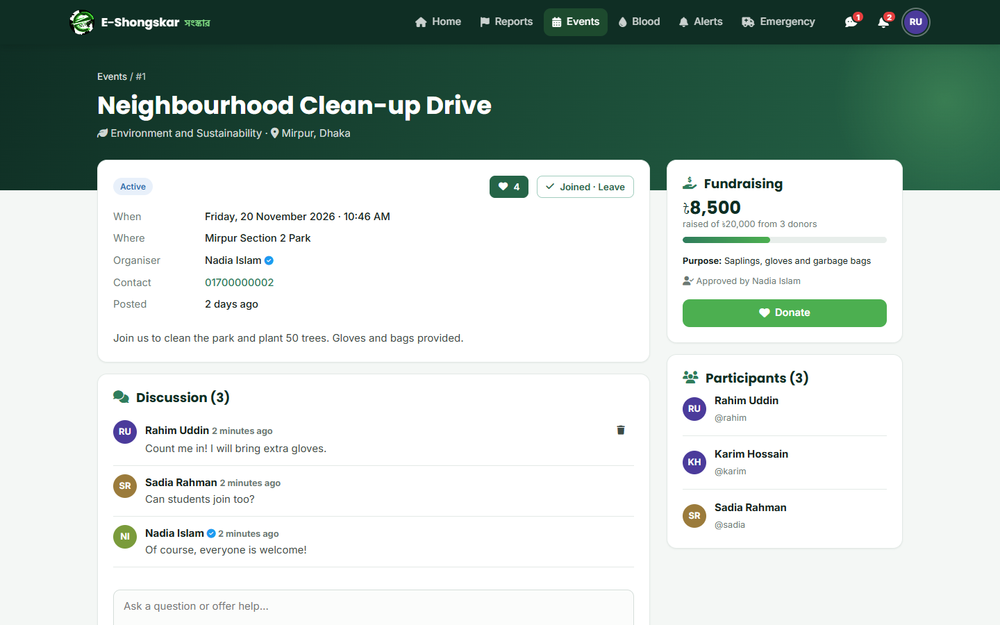 |

### Blood donor network
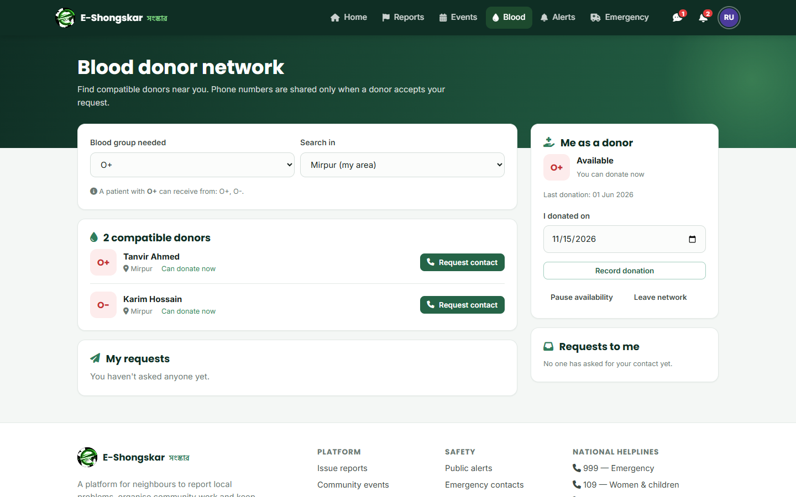

### Alerts & emergency
| Public alerts | Emergency contacts & SOS |
|---|---|
| 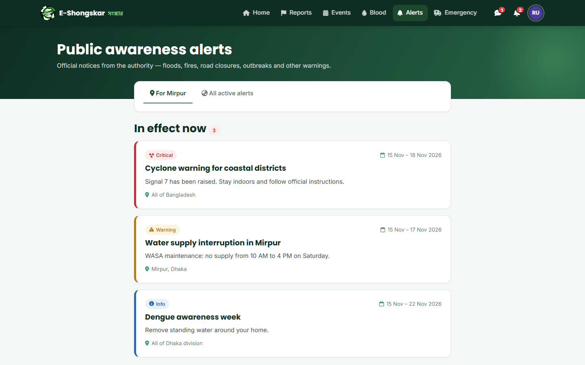 | 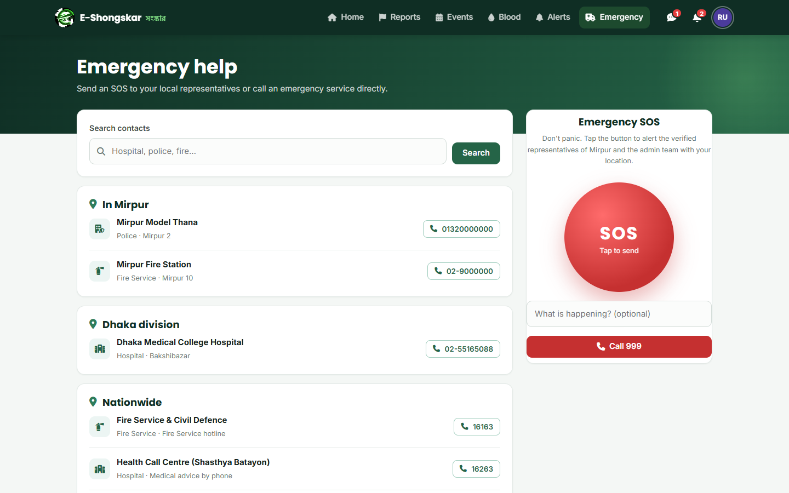 |

### Messages & leaderboard
| Neighbour chat | Leaderboard |
|---|---|
| 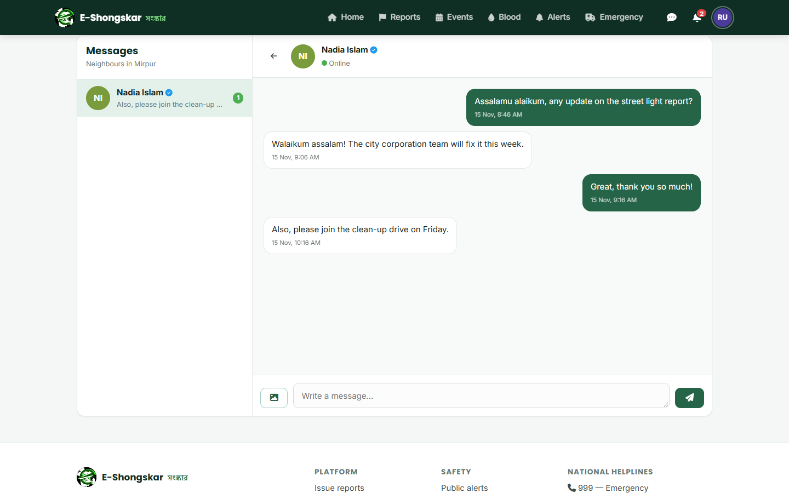 | 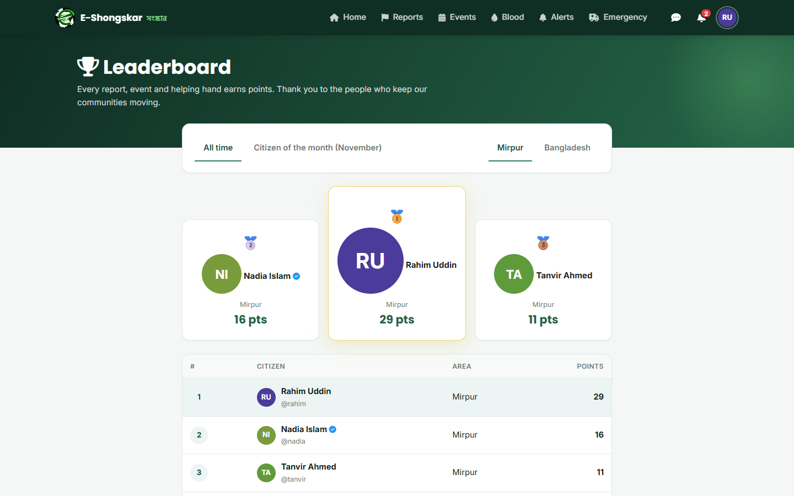 |

### Admin panel
| Admin dashboard | Report management |
|---|---|
| 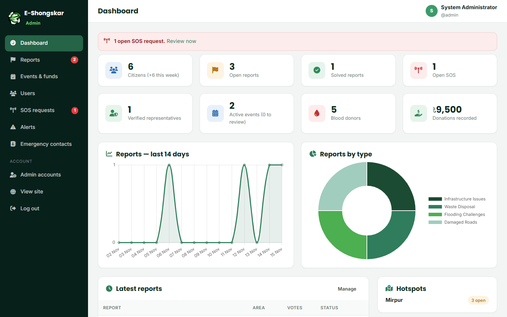 | 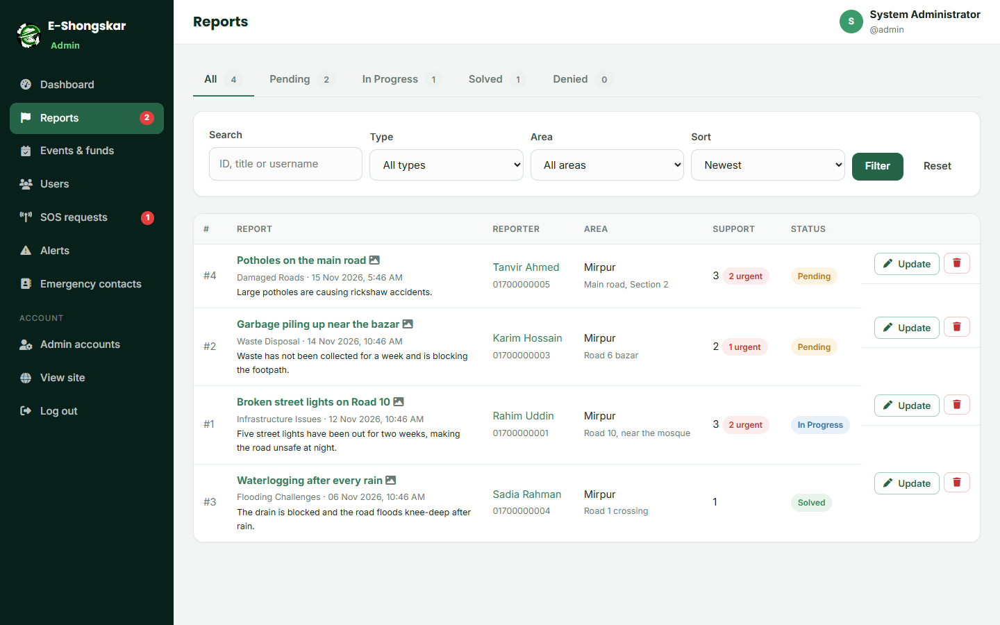 |

## Setup (XAMPP)

1. Copy this folder into `C:\xampp\htdocs\` (for example `C:\xampp\htdocs\E-Shongskar`).
2. Start **Apache** and **MySQL** in the XAMPP Control Panel.
3. Open phpMyAdmin (`http://localhost/phpmyadmin`), go to the **SQL** tab, paste the contents of `database/e_shongskar.sql` and click **Go**. This creates the `e_shongskar` database.
4. Visit `http://localhost/E-Shongskar/`.

If your MySQL uses a password or a different port, edit `includes/config.php`.

**Default admin:** username `admin`, password `admin123`. Log in at *Log in → Admin* and change the password under *Admin accounts*.

## Features

| Area | What it does |
|---|---|
| Issue reports | Report a problem with a photo; neighbours vote and rate urgency; admins update the status and everyone involved is notified. |
| Community events | Create events, like, comment and join. Organisers can request a fundraiser, which a verified local representative (or an admin) approves before donations open. |
| Event completion | Organiser marks it completed → a verified local representative verifies it → an admin approves it. |
| Blood donors | Register as a donor, search compatible donors in your area or division, and request a phone number. The donor decides whether to share it. |
| Alerts | Admins publish alerts for the whole country, a division or a single area. |
| Emergency | Local, division and national emergency numbers, plus an SOS button that alerts local representatives and admins and can include your location. |
| Messages | Neighbours in the same area can chat when at least one of them is a verified representative. |
| Leaderboard | Points for reports (5), events (4), approved events (6), approved fundraisers (10) and events joined (2); all-time and Citizen of the Month. |
| Admin panel | Dashboard with charts, report management, user verification, admin promotion, event and fundraiser approvals, SOS, alerts, emergency contacts and admin accounts. |

## Project structure

```
index.php, login.php, register.php, logout.php   Public pages
dashboard.php                                    Citizen home
reports.php, report.php, report_new.php          Issue reports
events.php, event.php, event_new.php,
completed_events.php                             Community events
blood.php, alerts.php, emergency.php             Safety
chat.php, notifications.php, neighbours.php,
profile.php, leaderboard.php                     Community & account
admin/                                           Admin panel
includes/                                        Config, database, helpers, layouts
assets/                                          CSS, JS, images, video
uploads/                                         User uploads (avatars, reports, chat)
database/e_shongskar.sql                         Full database script
docs/screenshots/                                README screenshots
```
